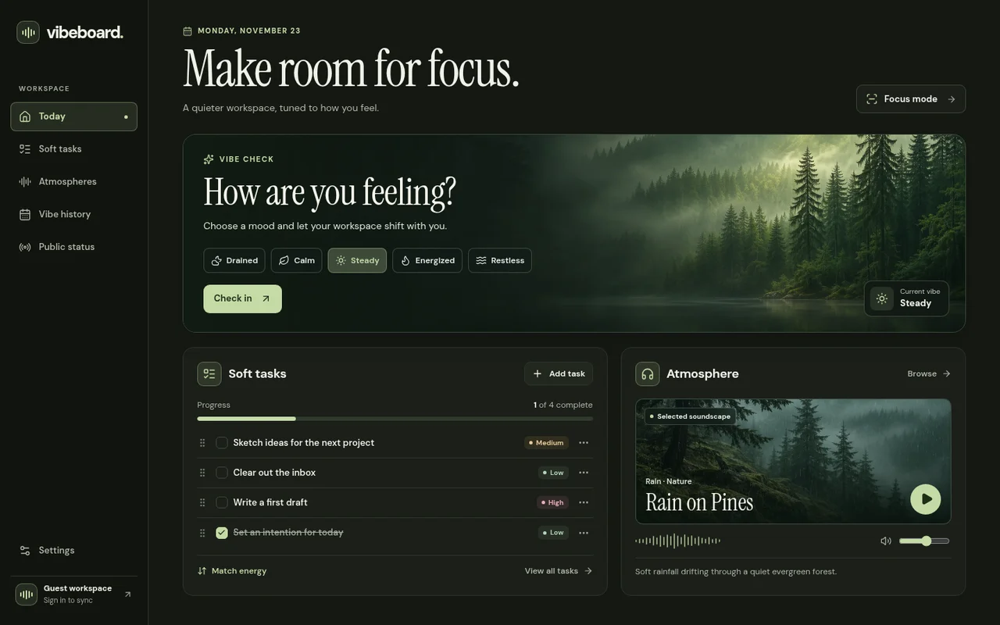

# VibeBoard

VibeBoard is a mood-aware workspace for soft tasks and quiet focus. Check in with how you feel, find work that matches your energy, and settle into an original soundscape.



## Run locally

Use Node.js 22.13 or newer.

```bash
npm ci
npm run dev
```

Open [VibeBoard](http://localhost:3000). The guest workspace starts with sample tasks and saves changes in your browser. To try synced workspaces and shareable status pages, create an account using email and a password. Each account starts with an empty workspace.

```bash
npm run lint
npm run typecheck
npm run build
npm start
```

## What’s included

- **Vibe check** pairs a mood with energy and intensity ratings, a private journal note, and optional dictation. A check-in updates your palette, recommends an atmosphere, and can move energy-matched tasks up the list.
- **Soft tasks** support editing, completion, three energy levels, and drag-and-drop using a pointer or keyboard. Focus mode opens a distraction-free timer and starts the selected atmosphere.
- **Atmospheres** are synthesized in the browser with Web Audio. Play rain, café ambience, soft synth, or a forest soundscape. A focus mix sequences three scenes according to your mood.
- **History** shows your last seven days and up to 120 check-ins. Signed-in workspaces sync through the database. Active and paused timers survive reloads.
- **Public status** lives at `/@username` when shared. Unlisted pages have a `noindex` directive, and private pages return a 404. The public card includes a summary derived from mood and ratings, the optional status message, and the optional running timer indicator. Journal notes and tasks stay in the workspace.

## Configure a hosted instance

Copy [.env.example](.env.example) to `.env.local` and enable the services you use.

| Capability | Variables |
| --- | --- |
| Hosted accounts | `BETTER_AUTH_URL` for your public HTTPS origin, `BETTER_AUTH_SECRET` with at least 32 characters, and a PostgreSQL `DATABASE_URL` |
| Email verification and magic links | `SMTP_URL`, `EMAIL_FROM` |
| Google sign-in | `GOOGLE_CLIENT_ID`, `GOOGLE_CLIENT_SECRET` |
| GitHub sign-in | `GITHUB_CLIENT_ID`, `GITHUB_CLIENT_SECRET` |
| AI check-in summaries | `AI_API_URL`, `AI_API_KEY`, `AI_MODEL` |
| Recorded-voice fallback | `TRANSCRIPTION_API_URL`, `TRANSCRIPTION_API_KEY`, optional `TRANSCRIPTION_MODEL` |
| Pro subscriptions | `STRIPE_SECRET_KEY`, `STRIPE_WEBHOOK_SECRET`, `STRIPE_MONTHLY_PRICE_ID`, `STRIPE_YEARLY_PRICE_ID` |

Generate an auth secret with `openssl rand -hex 32`. For OAuth, add `/api/auth/callback/google` or `/api/auth/callback/github` to your origin and register the resulting URL with the provider.

The app initializes the tables on first use. When using PostgreSQL, the configured connection needs schema creation access. Local accounts use SQLite and a generated auth secret in `.vibeboard/`. Set `VIBEBOARD_DATA_DIR` to an absolute persistent directory for a single-process self-hosted installation. Use PostgreSQL on stateless hosts such as Vercel.

`AI_API_URL` should point to a Chat Completions endpoint. When enabled, signed-in check-ins send the mood, ratings, and note to your chosen provider. VibeBoard falls back to its built-in summary when the provider is unavailable. Native dictation depends on the browser. The optional recorded-voice fallback sends a short audio clip to an audio transcriptions endpoint.

Create monthly and yearly recurring prices in Stripe and enable the customer portal. Register `/api/billing/webhook` for `customer.subscription.created`, `customer.subscription.updated`, and `customer.subscription.deleted`. Stripe confirms the Pro entitlement through those events. Pro removes VibeBoard branding from the status page.

The project ships under the [MIT License](LICENSE).
